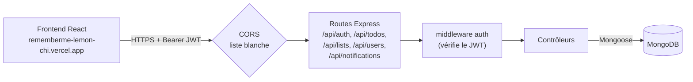
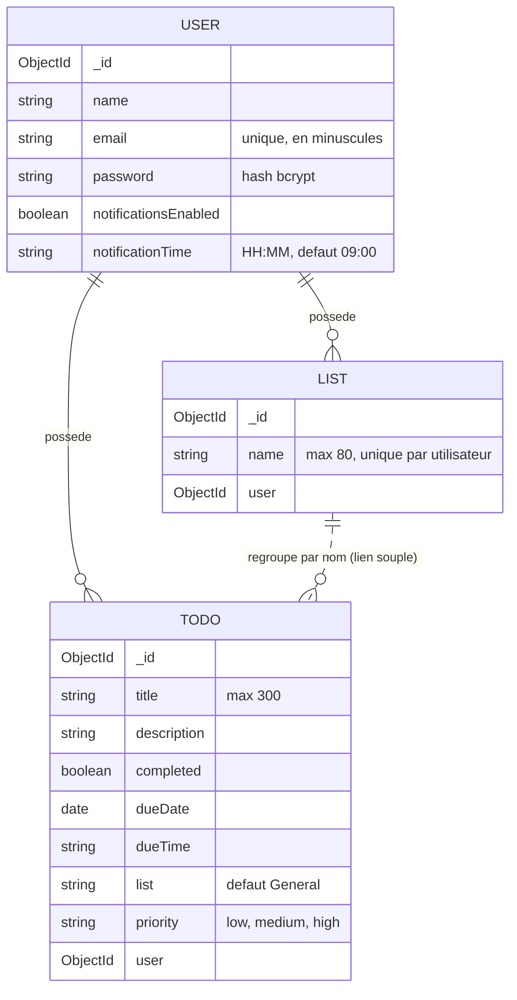

# RememberMe — API

> API REST de **RememberMe**, gestionnaire de tâches et de rappels par listes. **Ce dépôt est le backend.** L'interface est dans [Frontend_RememberMe](https://github.com/nagoloumdaniel/Frontend_RememberMe) : les deux dépôts forment un seul projet, **RememberMe**.


**API en production : https://backend-remember-me.vercel.app** · **Application : https://rememberme-lemon-chi.vercel.app**

## Le projet RememberMe

| Partie | Dépôt | Rôle | Production |
|---|---|---|---|
| Frontend | [Frontend_RememberMe](https://github.com/nagoloumdaniel/Frontend_RememberMe) | SPA React : interface, thème, calendrier | https://rememberme-lemon-chi.vercel.app |
| Backend (ce dépôt) | [Backend_RememberMe](https://github.com/nagoloumdaniel/Backend_RememberMe) | API REST Node/Express, MongoDB, JWT | https://backend-remember-me.vercel.app |



## Fonctionnement

L'API gère les comptes, les tâches (todos), les listes et les préférences de notification. Chaque requête protégée passe par un middleware qui vérifie le jeton JWT et place l'identifiant utilisateur dans `req.userId` ; les requêtes sur les tâches, listes et profils sont ensuite filtrées par cet identifiant, ce qui isole les données de chaque compte. Déployée en fonctions serverless sur Vercel, elle met en cache la connexion MongoDB entre les invocations (`config/db.js`).

### Endpoints

| Méthode | Route | Protégée | Description |
|---|---|---|---|
| POST | `/api/auth/register` | non | Inscription, renvoie un jeton JWT (validité 5 jours) |
| POST | `/api/auth/login` | non | Connexion, renvoie un jeton JWT (validité 7 jours) |
| GET | `/api/todos` | oui | Liste des tâches (filtres `list`, `completed`, `dueDate`) |
| GET | `/api/todos/:id` | oui | Détail d'une tâche |
| POST | `/api/todos` | oui | Création |
| PUT | `/api/todos/:id` | oui | Mise à jour |
| DELETE | `/api/todos/:id` | oui | Suppression |
| GET | `/api/notifications/today` | oui | Tâches non terminées dues aujourd'hui |
| GET | `/api/lists` | oui | Listes de l'utilisateur |
| POST | `/api/lists` | oui | Création d'une liste |
| GET | `/api/users/me` | oui | Profil |
| PATCH | `/api/users/me` | oui | Mise à jour (nom, notifications) |

Les routes protégées exigent `Authorization: Bearer <token>`.

### Limites connues

- **Pas de récupération de mot de passe** : le frontend contient des écrans « mot de passe oublié / code / réinitialisation », mais **aucun endpoint correspondant n'existe** dans cette API (ni code, ni envoi d'email). La fonction est incomplète.
- `GET /api/test` est annoncé comme point de contrôle, mais il est déclaré après les routeurs protégés : en pratique il répond 401 « aucun token » (constaté en production). Correctif possible : le déclarer avant le middleware d'authentification.
- Pas de limitation de débit, pas d'en-têtes de sécurité (Helmet), validation minimale à l'inscription et à la connexion.

## Modèle de données



Le champ `Todo.list` est une chaîne (nom de liste), pas une référence : le lien avec la collection `List` est volontairement souple.

## Sécurité

- Mots de passe hachés avec **bcryptjs** (12 tours) dans un hook `pre('save')`.
- Jeton **JWT** signé avec `JWT_SECRET`, vérifié par `middleware/auth.js`.
- **Isolation par utilisateur** : chaque accès est filtré par `req.userId` ; un test d'intégration vérifie qu'un compte ne lit pas les tâches d'un autre.
- Validation côté contrôleur (champs autorisés, dates, heure, priorité, longueurs).
- **CORS en liste blanche** : domaine de production du frontend, `localhost:5173` et `localhost:3000`.
- **Secrets** : aucun secret dans l'arbre actuel ni dans l'historique des fichiers suivis (recherche par motifs ciblés, sans lecture de valeurs) ; `.env` est ignoré par Git.
- Dépendances : `npm audit` signale des vulnérabilités, dont des niveaux élevés, à traiter dans une prochaine mise à jour.
- Signalement privé : voir [SECURITY.md](SECURITY.md).

## Stack technique (versions installées)

| Catégorie | Technologies |
|---|---|
| Runtime | Node.js (testé sous Node 24), Express 4.22.1 |
| Base de données | MongoDB via Mongoose 9.2.4 |
| Authentification | jsonwebtoken 9.0.3, bcryptjs 3.0.3 |
| Divers | cors 2.8.6, dotenv 17.3.1, http-errors 2.0 |
| Déploiement | Vercel, fonctions serverless (`vercel.json`, `@vercel/node`) |
| Tests | Jest 29.7.0, Supertest 6.3.4, mongodb-memory-server 9.5.0 |

## Défis rencontrés

- **Déploiement Vercel** : adapter une API Express au mode serverless (point d'entrée `api/server.js`, réécriture de toutes les routes) et mettre en cache la connexion MongoDB pour éviter une connexion par invocation.
- **CORS** : passage à une liste blanche d'origines, avec gestion explicite des requêtes préliminaires `OPTIONS`.
- **Secrets retirés** : après une alerte GitGuardian (juillet 2026), une branche de remédiation (PR #1) a ajouté `.env` au `.gitignore`. Par précaution, tout identifiant ayant pu être exposé doit être considéré comme compromis et renouvelé.
- **Tests réparés** : la suite d'intégration était cassée ; elle a été réparée et passe (6 tests sur 6).
- `node_modules` avait été commité au début du projet puis supprimé.

## Installation locale

```bash
git clone https://github.com/nagoloumdaniel/Backend_RememberMe.git
cd Backend_RememberMe
npm install
```

Créer un fichier `.env` (jamais commité) :

```
MONGODB_URI=<chaîne de connexion MongoDB>
JWT_SECRET=<longue chaîne aléatoire>
```

```bash
npm run dev     # nodemon, rechargement automatique
npm start       # node api/server.js
npm test        # Jest, en série (--runInBand)
```

Les tests utilisent **mongodb-memory-server**, qui télécharge un binaire MongoDB à la première exécution (accès réseau requis) ; aucune base distante n'est touchée. Ils couvrent l'authentification, le CRUD des tâches, les listes, le profil, les notifications du jour et l'isolation entre deux comptes.

## Statut

**Fonctionnel et en production.** Fonction incomplète : récupération de mot de passe (voir plus haut).

## Transparence sur l'outillage

Projet développé par Daniel Nagoloum Talla. Certains commits (README, réparation de la suite de tests) portent un trailer `Co-Authored-By: Claude` : ils ont été réalisés avec l'assistance d'un outil d'IA (Claude, Anthropic).

## Droits

**Aucune licence n'est accordée : tous droits réservés par défaut.** Le champ `license` de `package.json` valait `ISC`, valeur par défaut de `npm init` et non un choix documenté de l'auteur ; il a été remplacé par `UNLICENSED` pour ne pas laisser croire à une licence open source. Toute réutilisation nécessite l'accord de l'auteur (ouvrir une issue).

---

[GitHub @nagoloumdaniel](https://github.com/nagoloumdaniel) · [Portfolio](https://nagoloum.vercel.app)
